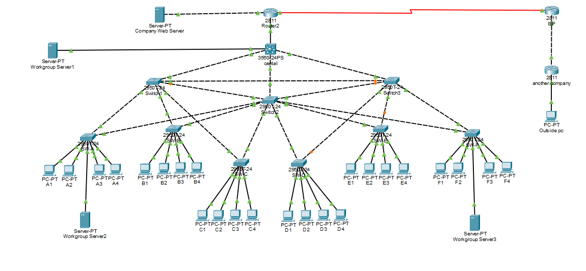

Enterprise network model (Cisco Packet Tracer)

File: `Enterprise_model_with_database_connection_simulation_from_the_outside.pkt`

A multi-layer corporate network:
- Catalyst 3560 core switch
- Redundant links between Cisco 2950 distribution and access switches
- 24 workstations, web and workgroup servers
- Cisco 2811 router connected to an ISP
- Simulated access from an outside PC

